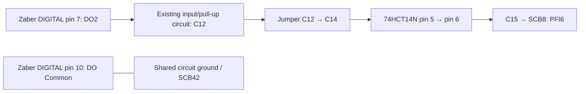

# MOBI scan-window wiring

Commissioned 2026-11-09 with the NI PCIe-6738, SCB-68A terminal block, Zaber DO2 and a
14-pin 74HCT14N Schmitt inverter. Terminal numbers below are physical numbered screw terminals.
SCB-68A reference inserts are DAQ-model-specific; the insert encountered during commissioning
labelled terminal 8 as +5 V and terminal 42 as PFI3, which does not match this PCIe-6738 pinout.

References: [NI PCIe-6738 pinout, Figure 3-1](https://docs-be.ni.com/bundle/ni-6738-6739-features/raw/resource/enus/375140b.pdf#page=22),
[Zaber X-MCC digital I/O](https://www.zaber.com/manuals/X-MCC),
and [74HCT14 pinout](https://www.ti.com/lit/ds/symlink/sn74hct14.pdf).

## Working breadboard connections

The chip straddles the centre gap, with its notch toward breadboard row 1 and pin 1 at row 10.
Viewed from above, pins 1–7 run down the left (A–E) side, and pins 14–8 run down the right (F–J) side.

| Function | Chip pin | Breadboard location | Connection |
| --- | --- | --- | --- |
| Supply | 14 | Row 10, F–J | Verified +5 V supply; PCIe-6738 SCB1 is +5 V |
| Ground | 7 | Row 16, A–E | Ground rail referenced to DAQ digital ground, SCB42 |
| Existing window input | 3 | C12 | Retain the existing Zaber DO2 input/pull-up circuit |
| Original window output | 4 | C13 | Isolated from the DAQ; no longer used for the window |
| Working inverter input | 5 | C14 | Jumper **C12 → C14**; remove C14's former ground tie |
| Working inverter output | 6 | C15 | Jumper **C15 → SCB8 / PFI6** |

If the supply wire lands at row 5 on the right side, it needs a jumper to row 10 on the right
side: those ordinary breadboard rows are not internally connected. Verify approximately 5 V
**at chip pin 14 relative to pin 7**, rather than relying only on the supply-rail voltage.

The original pin-3/pin-4 gate read HIGH on both input and output with correct supply voltage,
even when its DAQ jumper was removed. Reseating did not fix it; no replacement chip was installed.
The pin-5/pin-6 gate passed inversion and the full stationary signal-path test. This localizes the
original problem to that gate/contact section, without proving an internal silicon fault separately
from contact integrity. C13 is not the current window output.



DO Common is digital-connector pin 10; pin 5 is **DI Common**, a different terminal. Preserve
the established ground/reference connections. The Zaber isolated output requires its existing
input/pull-up and inverter circuitry to provide the intended TTL-level signal.

## DAQ terminal reference

| Physical SCB terminal | PCIe-6738 function | Use |
| --- | --- | --- |
| 1 | +5 V | Supply, if used for the breadboard |
| 42 | D GND PFI6/7 | Meter reference and circuit digital ground |
| 8 | PFI6 / P1.6 | Window signal from C15 |
| 38 | PFI1 / P1.1 | Encoder A |
| 7 | PFI5 / P1.5 | Encoder B |
| 53 | AO12 | Camera 1 Trigger In; also branched to SCB2 |
| 10 | AO0 | Camera 2 Trigger In; also branched to SCB3 |
| 2 | P0.0 | Actual camera 1 trigger TTL loopback |
| 3 | P0.1 | Actual camera 2 trigger TTL loopback |
| 40 | PFI4 / P1.4 | Camera 1 FIRE |
| 4 | PFI0 / P1.0 | Camera 2 FIRE |
| 6 | PFI3 / P1.3 | Separate status input; preserve existing wiring |

The camera trigger loopbacks remain in place. Proposed raw A/B loopback rewiring was not
performed during this repair. Encoder A/B and camera FIRE wiring were not changed.

## Stationary acceptance check

With acquisition stopped and controller window triggers disabled, command DO2 OFF → ON → OFF
without moving any stage or starting camera/AO output. Verify the full path:

| DO2 command | C12 / C14 inverter input | C15 output | PFI6 readback |
| --- | --- | --- | --- |
| OFF | Approximately 5 V | Approximately 0 V | LOW |
| ON | Approximately 0 V | Approximately 5 V | HIGH |
| OFF again | Approximately 5 V | Approximately 0 V | LOW |

Readback of DO2 is a controller logical state, not an independent voltage measurement. Use SCB42
as the common meter reference. If troubleshooting an unloaded output, disconnect only the
C15→SCB8 signal jumper; do not interpret the disconnected PFI6 input as evidence of gate state.
Switch off breadboard power before changing chip/power connections. Use resistance/continuity
mode only with the circuit unpowered.

The repaired path passed five DAQ samples in each OFF/ON/OFF phase, with the expected
LOW/HIGH/LOW levels. Final DO2 and PFI6 were LOW. No stages moved in this acceptance check.

## Normal acquisition configuration

```yaml
# Zaber X-axis scanner options
scan_window_output: 2
scan_window_triggers: [3, 4, 5]

# NI counter trigger options (inside the generator's trigger mapping)
type: counter
edge_source: pfi1
edge_filter_us: 20.48
window_source: pfi6
allow_high_window_at_start: false
bypass_window_start_for_diagnostics: false
```

Reserve those trigger IDs and DO2 exclusively for the scan window. IDs 3 and 4 are the one-shot
entry and upper-exit conditions; ID 5 is reserved but disabled and its actions cleared. An automatic
lower-exit condition is not armed. Normal acquisition verifies
PFI6 LOW before arming, waits for its rising edge, then emits a finite encoder-paced trigger train.
The falling window edge does not pause the train. Reset/finish/abort closes the controller window;
actual trigger counts and inferred exposure positions are still validated independently.

## Acquisition result after repair

The 2026-11-09 16:59 test swept X through a 37–38 mm window with 0.5 µm requested sampling,
1 s runway per side, approximately 16.152 µm/s, and two full-frame 1×1 Kinetix cameras in
16-bit Dynamic Range mode at 10 ms exposure. Both diagnostic bypasses were disabled.

| Measurement | Each camera |
| --- | --- |
| Actual electrical trigger TTLs | 2,000 |
| FIRE events | 2,000 |
| Saved images | 2,000 |
| TTLs before / inside / after the inferred window | 0 / 2,000 / 0 |
| Unmatched TTLs or FIREs | 0 |
| TTL → FIRE measured delay | 10 µs |
| Inter-camera FIRE skew | 0 measured, at 10 µs recording resolution |

Controller DO2 and DAQ PFI6 both reset LOW after cleanup. The pulse-count and camera-response
shortfalls were resolved for this pass. **Spatial validation still failed:** 103 exposure gaps per
camera exceeded tolerance; inferred TTL-to-TTL spacing ranged from 0.30 to 0.50 µm. The first
and last exposures were at inferred X=37.000275 and 37.989275 mm. The first-to-last span was
989 µm rather than the expected 999.5 µm. This is not a validated uniformly sampled volume.
The next investigation must distinguish physical motion, encoder signal conditioning and A/B
position-decoder behavior. Raw A/B and the gate waveform were not captured in that acquisition.

Raw data and executed timing notebooks remain on the microscope's NVMe storage. The run folder
is `20261109-165916-repaired-window-full-test`, under the MOBI first-test acquisition directory;
its browser report is `reports/ttl-cadence-notebook/ttl-cadence-position-camera-sync.html` and
the editable notebook has the same basename with `.ipynb`.
